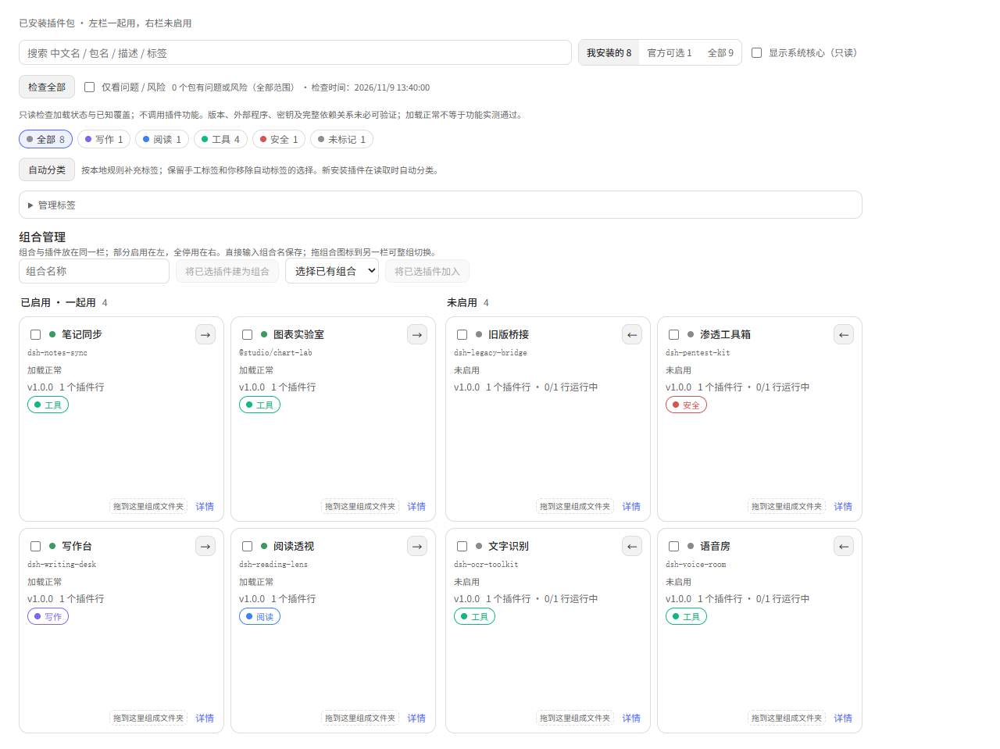

# dsh-plugin-packs · 插件包管理器

[](LICENSE)
[](https://github.com/deepseek-ai/deepseek-harness)
[](../../releases)
[](lib/client.js)
[](https://github.com/topics/dsh-plugin)

**中文** | [English](README.en.md)

> 把 DeepSeek Harness（dsh）已安装的插件包排成 Minecraft 资源包那样的**左右两栏**：
> 左边是**正在一起用的**，右边是**装好了但没启用的**。每张卡片可以挂标签，标签栏用来快速收窄范围。




*界面示意（示例数据）：左栏 4 个正在一起用的包，右栏 4 个装好但未启用的包。*

## 它解决什么

插件装到几十个之后，问题不再是"哪个插件叫什么"，而是**"我现在到底在跑什么"**——官方插件页是一张平铺的已安装清单，启用和停用的混在一起，靠记忆区分。

这个插件把同一批数据重新排成两栏，于是「开着什么」变成一眼可见的事实；再叠一层自定义标签（写作 / 联网 / 界面 / 安全 / 模型渠道 …），几十个包也能在两次点击内定位。

**与「插件分组 / 文件夹」类插件的区别：**

| | 本插件 | 文件夹 / 分组类 |
|---|---|---|
| 主视角 | **启用 vs 未启用**（全局两栏） | 用户自定义的层级分组 |
| 数据存在哪 | **`packs.json` 文件**（跟着 `DSH_HOME` 走） | 一般放浏览器 localStorage |
| 换浏览器 / 清站点数据 | 标签、中文名都在 | 分组一般会丢 |
| 能手改 / 能进版本库 | 能 | 一般不能 |
| 与前者关系 | 正交，可同时使用 | — |

一句话：分组回答"它属于哪一类"，两栏回答"它现在开没开"，本插件专做后者，并顺手把"哪一类"用标签补上。

## 安装

```powershell
# npm 包名（推荐）
dsh plugin --profile web add dsh-plugin-packs

# 官方 CLI 也支持直接从 GitHub 装
dsh plugin --profile web add github:mmmmlp-cloud/dsh-plugin-packs

# 或本地源码
git clone https://github.com/mmmmlp-cloud/dsh-plugin-packs.git
dsh plugin --profile web add ./dsh-plugin-packs
```

装完**重启一次 `dsh web`** 最稳（宿主侧要挂路由），然后按 `Ctrl+F5` 刷新页面。

入口：**左侧栏「插件」→ 顶部「已安装 | 插件包」→ 点「插件包」**。
（Dsh 有两个都叫"插件"的面：左侧栏那个整页面，和「设置 → 插件」。本插件挂在**前者**。）

## 用法

- **两栏**：左「已启用 · 一起用」，右「未启用」。卡片是正方形，每栏一行两个。
- **搬包**：点卡片右上箭头 `→` / `←`；也可以直接把卡片**拖到对面那一栏**。
- **批量**：勾选多张卡，顶部浮出「批量启用 / 批量停用」。
- **标签**：卡片上挂标签；顶部标签栏点一下即筛选，再点取消；「未标记」能捞出还没归类的包。
- **搜索**：匹配中文名、包名、描述、版本、标签。
- **范围**：我安装的（默认）/ 官方可选 / 全部；勾「显示系统核心」才露出只读区。
- **详情**：展开看完整描述、来源、包内插件行及其运行状态，还能改中文名、勾标签。展开时该卡横向占满整行。
- **反馈**：每次切换后底部提示区分四种真实结局——`已生效` / `需重启 DSH` / `被更高优先级覆盖` / `失败：<code>`，已生效且确实发生变更时提供**撤销**（撤销也先预检）。
- **记住位置**：点过「插件包」后，本次会话内切走再回来仍停在这一页。

## 体检与风险提示（0.2.0）

- 打开页面或点「检查全部」获取当前清单；卡片区分加载正常、有问题、有风险、未验证、未启用。仅 `fiberPhase=active` 计入运行中，不把 enabled 当作运行证明。
- 「仅看问题 / 风险」筛出有明确错误或警告的包；详情展示依据、影响、建议与检查范围。
- 只读检查包缺失、宿主兼容性错误、精确 entryId 的行状态与配置覆盖声明。部分行停用不等于包损坏；全部行停用时不显示“加载正常”。
- 覆盖声明只是风险，不代表两个包一定冲突；同类、同模块或共用槽位不是冲突证据。
- 箭头、拖放、批量与撤销共享操作前预检；风险汇总一次确认，明确版本/平台/缺包问题阻止启用。确认时重新检查，发现新风险要再次确认。批量遇到未生效结果立即停下，不继续盲切。
- 不自动修复、不自动启用来测试、不读取凭据、不调用插件功能、不上传清单。外部程序、密钥、完整依赖图、无明确错误的版本兼容性未验证；“加载正常”不保证业务功能可用或绝对无冲突。
- `GET /plugin-packs/api/diagnostics` 只读报告；`POST /plugin-packs/api/preflight` 请求 `{changes:[{name,enabled}]}`，需 `x-plugin-packs` 头；这两个接口不读写标签文件。

## 自动标签与文件夹组合（0.3.0）

- 点「自动分类」为现有用户安装包补充标签；后续新安装的包在读取页面时自动分类。规则只使用包名、描述及本地显示元数据，不调用模型、不联网；不认识就留空，可能多标签。
- 手工标签始终保留；自动标签标有「自动」。手工移除后会保存抑制记录，刷新及再次分类都不会擅自补回。删除整个分类也不会自动重建。
- 将插件拖到另一张卡片的「组成文件夹」区域建组；拖进组合卡片加入。也可勾选插件，填写组名创建，或选择已有组合加入。每个包只属于一个单层组合，加入新组会从旧组移出。
- 组合卡片与普通插件混排在原有左右栏：任一成员启用就放左栏，全停用或空组放右栏；混合状态明确显示「部分启用 n/总数」。组合名输入框折叠时也可直接编辑，点保存或按 Enter 保存。拖动组合图标到另一栏执行整组预检切换；只有图标可拖，名称输入不会触发拖动。组内成员不在两栏重复显示，搜索组名或成员名均能找到组合，展开后保留成员详情、标签和独立启停。
- 分组、改名、移出及解散都**不改变启停、不卸载包**。解散需再次点击确认；未知或已卸载成员也保留记录，可手动移出。
- 「全部启用 / 全部停用」明确作用于完整组合，不受搜索/标签/范围筛选影响。确认时重新读取组成员并重跑预检；成员变化导致提示变化时再次确认。系统或缺失成员先移出，不能静默跳过。
- 整组切换不是事务：遇到失败、被覆盖或需要重启就停止后续成员，并展示结果；不自动回滚其他包。已生效变更可以经预检撤销。
- 状态升级为 v2（含 revision、groups、autoTags、suppressedTags）；迁移前将原件备份为 `packs.json.v1.bak`。标签保存采用最新版本与 revision 校验，过期页面拒写，避免覆盖分组。备份依赖同目录硬链接支持，不支持时安全拒绝迁移；写队列只协调本进程，不替代外部编辑器或多进程文件锁。
- `POST /plugin-packs/api/state/actions` 提供 `auto-tag`、`group-create/add/remove/rename/dissolve`；需 `x-plugin-packs` 头。Agent 工具 `plugin_packs` 调用相同整理操作，不提供风险确认或隐式启停。

## 数据在哪

标签与中文名存在一个普通 JSON 文件里：

```
<$DSH_HOME>/plugin-packs/packs.json        # 默认 C:\Users\<你>\.dsh\plugin-packs\packs.json
```

```json
{
  "version": 2,
  "revision": 1,
  "groups": [],
  "tags": [{ "id": "novel", "label": "小说 · 阅读", "color": "#7B68EE" }],
  "packs": {
    "dsh-novel-writer": { "name": "小说写作助手", "tags": ["novel"] }
  }
}
```

- **键是包名**（不是 entry id）：重装、升级、换 id 都不丢标签。
- 文件不存在时生成一份空表 + 7 个**通用分类标签**（小说·阅读 / 联网搜索 / 界面美化 / 安全·渗透 / 模型渠道 / 记忆·知识 / 工具·其它），具体包的分类由本地规则和你的手工标签共同决定——**出厂不预填任何包**：谁在用哪些插件属于使用者的私人信息，装一个管理工具不该顺手把"作者用过什么"印进代码里；何况陌生人机器上也没有那些包。
- **可以手改**，改完刷新页面即生效；格式写错也不会静默丢数据——坏文件先完整备份（`packs.json.broken-<唯一标识>`）再重建；备份失败则拒绝覆盖原件。
- 写入是原子写（临时文件 + rename）且串行化，连续点标签不会互相吞更新。

**只与插件包相关，不碰会话、提示词、凭据。**

## 它改的是哪一层

「启用 / 停用」= 调用内核的 `pluginManager.setBundleEnabled`，语义是**把包加入 / 移出 profile 的 bundle 选择层**：

- 依赖仍留在 `node_modules`，随时可以移回来，**不是卸载**；
- 改的是真实插件状态，不是只有本页的显示；
- 由上层配置接管（只读）的包会明确标出，不会假装能改。

包内**单个 loader 行**的开关不在本插件职责内（那是「插件管家」那类行级工具的事）；本页里包内行列表是只读展示。

## 范围与只读

| 范围 | 内容 |
|---|---|
| 我安装的（默认） | `availability === "profile"`，也就是你自己装进来的包 |
| 官方可选 | 随 dsh 安装附带的 `@deepseek-ai/dsh-experimental-*` 等可选包 |
| 全部 | 上面两者 |
| 显示系统核心（勾选后） | 只读区：`dsh-base` / `dsh-web-app`，以及 **acp / headless / sdk-app / sdk-minimal** 这几种别的运行模式的包。一律不可切，避免误触改坏桌面档 |

仅供安装的缺失候选包不显示；已选择或已安装但缺失的异常包保留可见，便于诊断。

## 架构

一个包，两个 half，零运行时依赖、无构建步骤：

```
dsh-plugin-packs/
├── package.json          # dsh.bundle.patch + dsh.client
├── cordis.patch.yml      # 插入 plugin-packs 一行（纯增量，不替换任何既有行）
├── lib/index.js          # 宿主 half：同源数据路由
├── lib/client.js         # 浏览器 half：两栏 UI（React，纯 ESM）
├── locale/{zh,en}.json   # 插件页/清单里显示的名称与描述
├── icon.svg
└── scripts/render-check.mjs   # 离线渲染自检（无浏览器也能验 UI）
```

数据全部走**宿主 half 的同源路由**，浏览器端不碰远程命名空间：

| 方法 | 路径 | 说明 |
|---|---|---|
| GET | `/plugin-packs/api/health` | 自检：`build` 标记、路由、数据文件路径 |
| GET | `/plugin-packs/api/bundles` | 包清单 + 行状态 + 同次快照体检（`{ bundles, plugins, diagnostics }`） |
| POST | `/plugin-packs/api/bundles/enabled` | 整包启停，body `{ name, enabled }`，返回官方 `ChangeResult`；需 `x-plugin-packs: 1` 头 |
| GET | `/plugin-packs/api/state` | 读标签文档（不存在则按出厂内容生成） |
| PUT | `/plugin-packs/api/state` | 整份替换写入；需 `x-plugin-packs: 1` 头 |

> 为什么不让浏览器直接调 `ctx.remote.pluginManager`：那一层要接客户端远程装配顺序，容易在启动竞态里静默失败（标签页凭空消失，没有报错）。宿主路由既能用 `curl` 单独验证，也不受装配顺序影响。写操作要求自定义请求头，跨源页面设不了自定义头而不触发预检，这条路由不答预检，所以别的本地页面无法借道改动你的插件状态。

## 排错

| 症状 | 处理 |
|---|---|
| 标签条里没有「插件包」 | 它挂在**左侧栏「插件」**页里，不是「设置 → 插件」。先确认 `~/.dsh/profiles/<profile>/package.json` 的 `dsh.profile.bundles` 里还有 `dsh-plugin-packs`（被取消选择时这一行会整条消失）；恢复后 `Ctrl+F5` |
| 页面报 `HTTP 404 / 响应不是 JSON` | 宿主 half 没挂上。`curl 127.0.0.1:<端口>/plugin-packs/api/health` 看 `build` 字段是否存在 |
| 改了宿主代码没生效 | 按安装结果处理；更新已加载的宿主模块可能需要重启 DSH，不能仅靠关再开保证刷新模块；`health` 的 `build` 用于核实实际版本 |
| 切换后"需重启" | 个别包（尤其宿主侧插件）要重启 `dsh web` 才完全生效，提示里会写 |
| 切换后页面行为没变 | 浏览器 half 的插件完全卸载需要刷新页面（`Ctrl+F5`），宿主 half 是立即生效的 |

## 开发

```powershell
npm test                                              # 状态/体检/工具及离线交互测试
node scripts/render-check.mjs                          # 离线结构与交互自检（非视觉验收）
node scripts/render-check.mjs --profile <profile 目录>  # 指定 profile 取 react/react-dom
node --check lib/client.js && node --check lib/index.js
```

`render-check.mjs` 用一个只替换 hook 的 mock React 直接渲染组件，覆盖默认两栏 / 搜索 / 标签筛选 / 系统区 / 官方范围 / 错误态 / 详情展开 / 加载中八组场景——没有浏览器也能在改 UI 时拿到真实报错。

## 已知边界

1. 只管到**包**这一层；包内行级开关请配合行级插件管理工具。
2. 标签存本机文件，不随 dsh 账号同步；换机器请拷 `packs.json`。
3. 官方「已安装」标签无法被替换（它的内容由页面内部渲染，不是插槽条目）；本插件以并列标签的形式提供另一种视角。
4. 与同类插件（`dsh-plugins-folders` 的分组、`dsh-plugin-namecards` 的名称卡）**可以同时安装**，彼此不写同一份数据。

## 许可

[MIT](LICENSE) © mmmmlp-cloud

本插件基于 DeepSeek Harness 的公开插件机制构建，与 DeepSeek 官方无隶属关系。

[](https://github.com/deepseek-ai/deepseek-harness)
